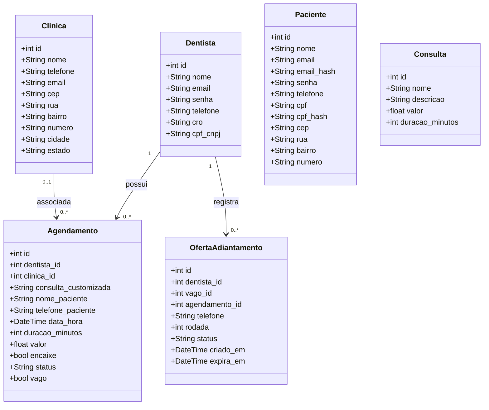

# ReOdonto

Aplicativo para gerenciamento de agendamentos odontológicos e realocação de pacientes. O sistema ajuda dentistas a aproveitar horários que ficariam vagos após cancelamentos, realizar encaixes e acompanhar os resultados da agenda.

**Público-alvo:** dentistas e profissionais responsáveis pela agenda de clínicas odontológicas.

**Turma:** 3A2  
**Integrantes:** Lucas Caldas, Arthur Munaier, Eduardo Aquino e Yslan Cirilo.

---

## Problema que o projeto busca resolver

Quando um paciente cancela uma consulta, o horário pode ficar vazio e representar perda de atendimento e receita para a clínica. O ReOdonto permite registrar o cancelamento, liberar o horário, encaixar outro paciente e oferecer antecipações por WhatsApp. O painel reúne indicadores para acompanhar o aproveitamento da agenda.

## Tecnologias utilizadas

| Parte                   | Tecnologia                       | Utilização                                                           |
| ----------------------- | -------------------------------- | -------------------------------------------------------------------- |
| Frontend                | Flutter / Dart                   | Interface utilizada pelo dentista.                                   |
| Backend                 | Python / Flask                   | API REST e regras de negócio.                                        |
| Persistência            | SQLite / SQLAlchemy ORM          | Mapeamento das entidades e armazenamento dos dados.                  |
| Autenticação            | JWT                              | Autenticação e proteção das rotas do dentista.                       |
| Automação               | n8n                              | Orquestração do fluxo de mensagens do WhatsApp.                      |
| Inteligência artificial | Claude, por meio do fluxo do n8n | Interpretação das solicitações de agendamento enviadas por mensagem. |
| Integração externa      | WhatsApp e BrasilAPI             | Comunicação com pacientes e consulta de CEP.                         |

---

## Funcionalidades Implementadas

A lista abaixo reúne os fluxos e operações disponíveis no projeto. Para a avaliação, cada item deve ser verificado de ponta a ponta: interface ou entrada externa → API → Controller → Service → Model/Repository → banco de dados, conforme o tipo de funcionalidade.

### Autenticação e perfil do dentista

1. **Cadastro de dentista:** criação de conta com dados pessoais e senha, com validação dos campos e prevenção de e-mail e CPF/CNPJ duplicados.
2. **Login de dentista com JWT:** autenticação por e-mail e senha e emissão de token para acessar as rotas protegidas.
3. **Visualização de perfil:** consulta dos dados do dentista autenticado.
4. **Atualização de perfil:** alteração dos dados pessoais, com validações de segurança.
5. **Logout:** remoção da conta do dentista e dos agendamentos associados.
6. **Login com Google:** autenticação por OAuth2, com verificação do token recebido.
7. **Recuperação de senha por código OTP:** solicitação, validação do código temporário e redefinição da senha.

### Agenda e realocação de pacientes

8. **Visualização da agenda diária:** apresentação dos agendamentos e horários vagos do dentista, organizados por data e horário.
9. **Criação de agendamento:** registro de uma consulta com paciente, tipo de atendimento, data, horário, duração e valor. O Service também verifica a duração e impede sobreposição com outros horários da agenda.
10. **Abertura de horário vago:** criação de um espaço disponível na agenda sem associar um paciente.
11. **Cancelamento de consulta com liberação de horário:** alteração do status da consulta para cancelado e abertura de um horário vago no mesmo período.
12. **Encaixe rápido de paciente:** associação de um paciente que chegou à clínica a um horário vago existente.
13. **Confirmação de atendimento:** alteração do status do agendamento para concluído.
14. **Alertas de horários vagos:** exibição dos próximos horários disponíveis para encaixe.

### Gestão e acompanhamento

15. **Cadastro de clínica:** registro de uma clínica com seus dados de identificação e endereço.
16. **Catálogo de tipos de consulta:** consulta dos tipos de atendimento, incluindo descrição, valor e duração.
17. **Painel de indicadores:** apresentação de horários recuperados, pacientes encaixados, taxa de ocupação, ociosidade, cancelamentos e prejuízo evitado.

### Integração com WhatsApp e IA

18. **Agendamento pelo WhatsApp com IA:** o paciente envia uma solicitação; o fluxo do n8n utiliza IA para interpretar os dados e chama a API do ReOdonto para verificar disponibilidade e registrar o agendamento ou sugerir alternativas.
19. **Cancelamento pelo WhatsApp:** recebimento de uma solicitação de cancelamento pela integração e encaminhamento à API para localizar e cancelar o agendamento correspondente.
20. **Oferta automática de antecipação:** depois que um horário é liberado, o sistema seleciona um paciente com consulta futura e envia uma oferta pelo WhatsApp. A resposta do paciente é processada e, se ele aceitar, o agendamento é transferido para o horário disponível.

## Arquitetura e responsabilidades

O backend está organizado em camadas para separar o recebimento das requisições, as regras de negócio, o acesso aos dados e a representação das entidades.

| Camada         | Diretório               | Responsabilidade no projeto                                                                                                                                                                   |
| -------------- | ----------------------- | --------------------------------------------------------------------------------------------------------------------------------------------------------------------------------------------- |
| Controller     | `backend/controllers/`  | Recebe requisições HTTP, interpreta parâmetros e JSON, aciona o Service correspondente e devolve respostas JSON com os códigos HTTP. Os módulos registram rotas por meio de Flask Blueprints. |
| Service        | `backend/services/`     | Executa as regras de negócio e coordena os casos de uso, como validar conflitos, cancelar consultas, realizar encaixes, calcular indicadores e tratar solicitações vindas do WhatsApp.        |
| Model          | `backend/models/`       | Representa as entidades persistidas. As entidades utilizam SQLAlchemy e herdam de `db.Model`.                                                                                                 |
| Repository     | `backend/repositories/` | Concentra consultas de dados e filtros específicos usados pelos Services, como busca de horários vagos, agendamentos futuros e horários que se sobrepõem.                                     |
| Banco de dados | `backend/database/`     | Configuração da conexão e arquivos relacionados ao SQLite.                                                                                                                                    |

**Observação sobre a implementação atual:** nos arquivos consultados do repositório, os handlers dos Controllers estão definidos como funções registradas em Flask Blueprints, e os Services também estão implementados como funções em módulos. A atividade solicita Controllers e Services implementados como classes. Além disso, o Repository atual contém alguns auxiliares de persistência simples (`adicionar`, `remover` e `confirmar`). Esses pontos precisam ser adequados no código para cumprir literalmente o padrão exigido; a documentação, por si só, não substitui essa alteração.

### Integrações externas

A integração de WhatsApp está separada da interface Flutter:

- `backend/controllers/integracao_controller.py` disponibiliza os endpoints de integração e valida a chave recebida no cabeçalho `X-API-Key`.
- `backend/services/whatsapp_service.py` trata solicitações de agendamento, cancelamento e respostas às ofertas.
- `backend/services/adiantamento_service.py` seleciona pacientes elegíveis, registra as ofertas e trata respostas, recusas e expiração.
- `backend/services/ponte_whatsapp.py` encapsula o envio de mensagens à ponte de WhatsApp.
- `n8n/` contém o fluxo que recebe a mensagem, utiliza IA para interpretar o pedido e chama a API do ReOdonto. A chamada ao provedor de IA é orquestrada nesse workflow; o backend recebe os dados interpretados e aplica as regras de agendamento.

As chaves e credenciais devem ser configuradas por variáveis de ambiente no `.env`. O arquivo `.env.example` serve como modelo. Não publique tokens, senhas ou chaves reais no repositório.

---

## Estrutura do repositório

```text
ReOdonto/
├── frontend/
│   └── lib/
│       ├── main.dart
│       ├── pages/          # Telas do aplicativo
│       ├── widgets/        # Componentes reutilizáveis
│       ├── services/       # Comunicação HTTP e sessão
│       ├── models/         # Modelos usados no frontend
│       ├── utils/          # Máscaras, validadores e formatadores
│       └── theme/          # Cores e tema visual
├── backend/
│   ├── app.py              # Inicialização da API Flask
│   ├── controllers/        # Rotas e Blueprints
│   ├── services/           # Regras dos casos de uso
│   ├── models/             # Entidades SQLAlchemy
│   ├── repositories/       # Consultas e acesso a dados
│   ├── database/           # Configuração e banco SQLite
│   ├── tests/              # Testes automatizados
│   ├── requirements.txt
│   └── seed.py              # Dados iniciais para desenvolvimento
├── n8n/                    # Workflow de integração com WhatsApp e IA
├── .env.example            # Modelo das variáveis de ambiente
└── README.md
```

---

## Diagrama de classes

O diagrama abaixo representa as Models do domínio consultadas no backend e seus principais atributos. Ele está incluído neste README, no caminho `README.md` → seção **Diagrama de classes**.



---

## Como executar o projeto

### Backend — Flask

Pré-requisitos: Python instalado.

```bash
cd ReOdonto/backend
pip install -r requirements.txt
```

Crie o arquivo `.env` a partir do modelo e preencha as chaves necessárias:

```bash
cp ../.env.example .env
```

No Windows, o arquivo também pode ser copiado manualmente. Configure as variáveis de ambiente exigidas pelo ambiente, como `SECRET_KEY`, `JWT_SECRET_KEY`, `ENCRYPTION_KEY` e, para integrações, as respectivas chaves e URLs. Em seguida, inicie a API:

```bash
python app.py
```

A API local utiliza a porta `5000`.

Para popular o banco com dados iniciais de desenvolvimento, execute uma vez:

```bash
python seed.py
```

### Frontend — Flutter

Pré-requisitos: Flutter SDK configurado e um dispositivo ou navegador disponível.

```bash
cd ReOdonto/frontend
flutter pub get
flutter run -d chrome
```

Para executar em um emulador Android, mantenha a API ativa e confira o endereço-base configurado em `frontend/lib/services/api_service.dart` (`10.0.2.2:5000` para o emulador Android).

## Testes

O backend possui um teste de verificação dos fluxos principais em banco temporário. Para executá-lo:

```bash
cd ReOdonto/backend
python tests/smoke_test.py
```
