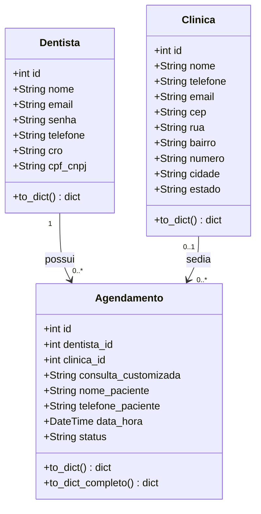

# ReOdonto

App para gerenciar a realocação de clientes de uma clínica odontológica, permitindo reorganizar consultas entre horários, cadeiras e dentistas disponíveis de forma rápida e organizada.

## Tecnologias utilizadas

- **Flutter** — front-end, interface para recepcionistas e atendentes acompanharem e remanejarem os agendamentos.
- **Python / Flask** — back-end (API REST), responsável pelas regras de negócio e pela comunicação com o banco de dados.
- **SQLite** — banco de dados, armazenamento dos dados de clientes, dentistas, horários e consultas.

---

## Funcionalidades Implementadas

### Autenticação e Controle de Acesso

1. **Cadastro de paciente** — criação de conta com validação de campos obrigatórios (nome, e-mail, senha), verificação de duplicidade de e-mail e CPF, e validação de endereço via BrasilAPI.
2. **Login de paciente com JWT** — autenticação via e-mail e senha; retorna token JWT assinado (HS256) com dados do paciente embutidos no payload (`nome`, `email`, `tipo`).
3. **Login de dentista com JWT** — autenticação exclusiva para dentistas; token carrega `dentista_id` como claim adicional para controle de acesso nos agendamentos.
4. **Autenticação com Google OAuth2** — login/cadastro de pacientes via conta Google; suporta fluxo web (redirect) e fluxo mobile (verificação de `id_token` ou `access_token`); cria conta automaticamente se o e-mail não existir no banco.
5. **Autorização por identidade no JWT** — pacientes só acessam, editam e deletam o próprio perfil; dentistas só visualizam, alteram e excluem os próprios agendamentos.

### Gestão de Pacientes

6. **Visualização de perfil** — paciente autenticado consulta seus próprios dados descriptografados (`GET /pacientes/<id>`).
7. **Atualização de perfil** — paciente edita nome, e-mail, telefone, CPF e endereço, com revalidação de duplicidade e de correspondência CEP/logradouro.
8. **Exclusão de conta** — paciente remove a própria conta; operação protegida por JWT.

### Gestão de Dentistas

9. **Cadastro de dentista** — criação de perfil com CRO e CPF/CNPJ únicos.
10. **Listagem de dentistas** — lista todos os dentistas cadastrados, com filtro opcional por clínica (`GET /dentistas/?clinica_id=X`).

### Gestão de Agendamentos

11. **Criação de agendamento** — dentista logado cria um slot com data/hora, clínica e tipo de consulta; o `dentista_id` é extraído automaticamente do token.
12. **Listagem de agendamentos do dentista** — retorna todos os agendamentos do dentista autenticado, com dados completos (nome da clínica, endereço, paciente).
13. **Atualização de status do agendamento** — dentista altera o status de um agendamento (`agendado`, `concluido`, `cancelado`) via `PATCH /agendamentos/<id>/status`.
14. **Preenchimento rápido de paciente walk-in** — dentista associa nome e telefone de um paciente presencial a um horário vago via `PATCH /agendamentos/<id>/paciente-rapido`.
15. **Exclusão de agendamento** — dentista remove um agendamento próprio.

### Gestão de Clínicas e Consultas

16. **CRUD de clínicas** — criação, listagem paginada (`page` / `per_page`), busca por ID, atualização e exclusão de clínicas.
17. **CRUD de tipos de consulta** — criação, listagem, busca, atualização e exclusão de procedimentos odontológicos com nome, descrição, valor e duração estimada.

### Segurança e Infraestrutura

18. **Criptografia de dados pessoais (PII)** — campos sensíveis do paciente (nome, e-mail, telefone, CPF, endereço) são **criptografados em repouso** com AES via Fernet; e-mail e CPF possuem colunas `*_hash` (SHA-256) para buscas seguras sem expor os dados cifrados.
19. **Recuperação de senha com OTP** — fluxo completo de recuperação: geração de código OTP de 6 dígitos via CSPRNG (`secrets.randbelow`), armazenamento apenas do hash SHA-256, expiração em 15 minutos, rate-limit de 3 tentativas/hora por e-mail e envio via SMTP/STARTTLS com verificação prévia da caixa via IMAP.
20. **Consulta de endereço por CEP** — integração com a BrasilAPI (`GET /cep/<cep>`) para autopreenchimento de logradouro, bairro, cidade e estado; utilizada também na validação do endereço do paciente no cadastro e na atualização.

---

## Diagrama de Classes

O diagrama de classes do projeto está em:

```
ReOdonto/docs/diagrama_classes.md
```

Ele cobre todas as entidades do sistema (`Paciente`, `Dentista`, `Clinica`, `Consulta`, `Agendamento`, `RecuperacaoSenha`), seus atributos, métodos e relacionamentos, e é renderizável diretamente no GitHub e GitLab via [Mermaid](mermaid.js.org).

---

## Estrutura do repositório

```
ReOdonto/
├── docs/
│   └── diagrama_classes.md   ← diagrama de classes (Mermaid)
├── frontend/                 ← interface Flutter
└── backend/
    ├── app.py
    ├── controllers/          ← rotas HTTP (Blueprints Flask)
    ├── models/               ← entidades SQLAlchemy
    ├── services/             ← regras de negócio
    ├── utils/                ← criptografia e utilitários
    └── database/
        └── create_database.sql
```

---

A API ficará disponível em `http://localhost:5000`.

---

## Nome dos participantes

- Eduardo Aquino
- Lucas Caldas
- Arthur Augusto
- Yslan Cirilo

# ReOdonto

App para gerenciar a realocação de clientes de uma clínica odontológica, permitindo reorganizar consultas entre horários, cadeiras e dentistas disponíveis de forma rápida e organizada.

## Tecnologias utilizadas

- **Flutter** — front-end, interface para recepcionistas e atendentes acompanharem e remanejarem os agendamentos.
- **Python / Flask** — back-end (API REST), responsável pelas regras de negócio e pela comunicação com o banco de dados.
- **SQLite** — banco de dados, armazenamento dos dados de clientes, dentistas, horários e consultas.

---

## Funcionalidades Implementadas

Todas as funcionalidades abaixo existem no back-end **e** funcionam na tela do front-end. O app é de uso exclusivo do dentista.

### Autenticação e Controle de Acesso

1. **Cadastro de dentista** — fluxo em duas telas (dados pessoais → criação de senha) com nome, e-mail, telefone, CPF/CNPJ e CRO; o back-end valida CPF/CNPJ com dígitos verificadores, exige senha de no mínimo 6 caracteres e garante e-mail e CPF/CNPJ únicos
2. **Login de dentista com JWT** — autenticação via e-mail e senha, retorna token JWT com validade de 8 horas, carregando `dentista_id`, `nome`, `email` e `tipo` no payload. A sessão fica salva no aparelho, mantendo o dentista logado ao reabrir o app.
3. **Autorização por identidade no JWT** — o dentista só visualiza, altera e cancela os próprios agendamentos; acesso a agendamento de outro dentista retorna `403`.

### Gestão do Perfil do Dentista

4. **Visualização de perfil** — dentista autenticado consulta seus dados.
5. **Atualização de perfil** — edição de nome, e-mail e telefone, com revalidação de e-mail duplicado.
6. **Logout** — encerra a sessão local, com confirmação.

### Gestão de Agenda e Realocação de Clientes

7. **Agenda diária** — lista os agendamentos do dentista logado, com faixa semanal para escolher o dia, indicação dos dias com consulta, linha do tempo ordenada por horário, contador de consultas e horários vagos e atualização por "puxar para atualizar".
8. **Criação de agendamento** — formulário em 3 etapas (nome e telefone do cliente → tipo de consulta → data e hora) via `POST /agendamentos/`; o `dentista_id` é extraído do token e o back-end impede dois agendamentos no mesmo horário para o mesmo dentista.
9. **Cancelamento de consulta** — dentista cancela um agendamento pelo cartão da consulta, atualizando o status para `cancelado`
10. **Encaixe rápido de cliente em horário vago** — dentista informa nome e telefone de um cliente que chegou pessoalmente e o associa a um horário vago

#### Autenticação adicional

11. **Login com Google (OAuth2)** — fluxo web (`/auth/google/login`, `/callback`, `/logout`) e verificação de `id_token`/`access_token` (`/auth/google/verify-token`); cria conta de paciente automaticamente.
12. **Recuperação de senha com OTP** — código de 6 dígitos gerado com CSPRNG, armazenado apenas como hash SHA-256, expiração em 15 minutos, limite de 3 tentativas por hora por e-mail e envio por SMTP. As telas existem no app, mas o back-end atende apenas cadastros de paciente.

#### Agendamentos e Dentistas

13. **Busca de agendamento por id** — restrita ao dentista dono do agendamento.
14. **Conclusão de consulta** — `PATCH /agendamentos/<id>/status` aceita `agendado`, `concluido` e `cancelado` (o app só envia `cancelado`); consultas concluídas não podem mais ser alteradas.

#### Clínicas e Consultas

15. **CRUD de clínicas** — criação, listagem paginada (`page` / `per_page`), busca por id, atualização e exclusão.
16. **Consulta de endereço por CEP** — `GET /cep/<cep>`, integração com a BrasilAPI para logradouro, bairro, cidade e estado (o app consulta a BrasilAPI diretamente).

---

## Diagrama de Classes



`status` pode ser `agendado`, `concluido` ou `cancelado`. Um agendamento sem `nome_paciente` representa um horário vago. O diagrama é renderizado diretamente no GitHub e GitLab via [Mermaid](mermaid.js.org).

---

## Estrutura do repositório

```
ReOdonto/
├── frontend/                     ← interface Flutter
│   ├── assets/icons/
│   ├── web/ android/ ios/ ...    ← plataformas suportadas
│   └── lib/
│       ├── main.dart             ← rotas e tema do app
│       ├── pages/                ← telas (login, cadastro, agenda, perfil, menu)
│       ├── widgets/              ← componentes (agenda, cadastro, perfil, painel)
│       ├── services/             ← api_service, sessao_usuario
│       ├── models/               ← agendamento, resumo_painel
│       ├── utils/                ← máscaras, validadores, formatadores
│       └── theme/                ← paleta de cores
└── backend/
    ├── app.py                    ← aplicação Flask e registro dos Blueprints
    ├── seed.py                   ← cria a clínica inicial
    ├── requirements.txt
    ├── controllers/              ← rotas HTTP (Blueprints Flask)
    ├── models/                   ← entidades SQLAlchemy
    ├── services/                 ← regras de negócio
    ├── utils/                    ← criptografia e utilitários
    └── database/
        ├── db.py
        └── create_database.sql
```

---

## Nome dos participantes

- Eduardo Aquino
- Lucas Caldas
- Arthur Augusto
- Yslan Cirilo
