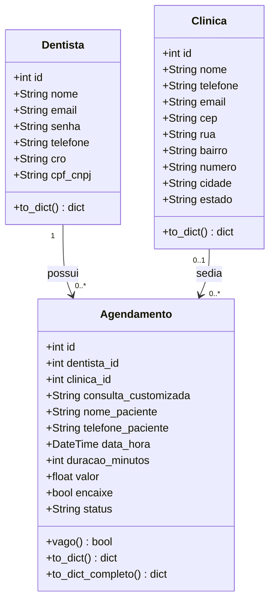

# ReOdonto

App para gerenciar a realocação de clientes de uma clínica odontológica, permitindo reorganizar consultas entre horários, cadeiras e dentistas disponíveis de forma rápida e organizada.

## Tecnologias utilizadas

- **Flutter** — front-end, interface para recepcionistas e atendentes acompanharem e remanejarem os agendamentos.
- **Python / Flask** — back-end (API REST), responsável pelas regras de negócio e pela comunicação com o banco de dados.
- **SQLite** — banco de dados, armazenamento dos dados de clientes, dentistas, horários e consultas.

---

## Funcionalidades Implementadas

Todas as funcionalidades abaixo existem no back-end **e** funcionam na tela do front-end. O app é de uso exclusivo do dentista.

### Autenticação e Controle de Acesso

1. **Cadastro de dentista** — fluxo em duas telas (dados pessoais → criação de senha) com nome, e-mail, telefone, CPF/CNPJ e CRO; o back-end valida CPF/CNPJ com dígitos verificadores, exige senha de no mínimo 8 caracteres (a mesma regra da tela) e garante e-mail (sem diferenciar maiúsculas) e CPF/CNPJ únicos
2. **Login de dentista com JWT** — autenticação via e-mail e senha, retorna token JWT com validade de 8 horas, carregando `dentista_id`, `nome`, `email` e `tipo` no payload. A sessão fica salva no aparelho, mantendo o dentista logado ao reabrir o app.
3. **Autorização por identidade no JWT** — as rotas do dentista exigem token do tipo `dentista` (um token de paciente recebe `403`); o dentista só visualiza, altera e cancela os próprios agendamentos e só lê, edita ou apaga o próprio perfil.

### Gestão do Perfil do Dentista

4. **Visualização de perfil** — dentista autenticado consulta seus dados.
5. **Atualização de perfil** — edição de nome, e-mail e telefone, com revalidação de e-mail duplicado; trocar a senha pelo perfil exige a senha atual.
6. **Logout** — encerra a sessão local, com confirmação.
7. **Exclusão de conta** — apaga o dentista e os agendamentos dele.

### Gestão de Agenda e Realocação de Clientes

8. **Agenda diária** — lista os agendamentos e os horários vagos do dentista logado, com faixa semanal para escolher o dia, indicação dos dias com consulta, linha do tempo ordenada por horário, contador de consultas e horários vagos e atualização por "puxar para atualizar".
9. **Criação de agendamento ou horário vago** — formulário em 3 etapas (nome e telefone do cliente → tipo de consulta, valor e duração → data e hora) via `POST /agendamentos/`. Com "Abrir horário vago" o horário nasce sem paciente. O `dentista_id` vem do token, e o back-end recusa horários que se sobrepõem considerando a duração (14:00 com 30 min bloqueia 14:15).
10. **Cancelamento que libera o horário** — ao cancelar uma consulta, o registro fica como `cancelado` (para o painel) e um horário vago é aberto no mesmo lugar, pronto para um encaixe.
11. **Encaixe rápido de cliente em horário vago** — dentista informa nome e telefone de um cliente que chegou pessoalmente e o associa a um horário vago; o horário passa a contar como recuperado no painel.
12. **Confirmação de atendimento** — o botão "Confirmar Atendimento" grava o status `concluido` na API; consultas concluídas não podem mais ser alteradas.
13. **Alertas de horários vagos** — tela com os próximos horários vagos e o valor que ainda dá para recuperar, cada um com o botão de encaixe.

### Painel Administrativo

14. **Indicadores de realocação** — `GET /painel/resumo` calcula prejuízo evitado (valor dos horários recuperados), ociosidade e taxa de ocupação (pelo tempo de agenda já passado), horários recuperados, pacientes encaixados, consultas realizadas e cancelamentos dos últimos 3 meses, e o gráfico de prejuízo evitado dos últimos 6 meses.

#### Autenticação adicional

15. **Login com Google (OAuth2)** — fluxo web (`/auth/google/login`, `/callback`, `/logout`) e verificação de `id_token`/`access_token` (`/auth/google/verify-token`); entra na conta de dentista com o mesmo e-mail ou cria uma. O `access_token` só é aceito se tiver sido emitido para o client ID do app.
16. **Recuperação de senha com OTP** — `/dentistas/recuperar-senha` e `/dentistas/redefinir-senha`: código de 6 dígitos gerado com CSPRNG, armazenado apenas como hash SHA-256, expiração em 15 minutos, limite de 3 pedidos por hora por e-mail (`429` ao exceder) e envio por SMTP.

#### Agendamentos e Dentistas

17. **Busca de agendamento por id** — restrita ao dentista dono do agendamento.

#### Clínicas e Consultas

18. **CRUD de clínicas** — criação, listagem paginada (`page` / `per_page`), busca por id, atualização e exclusão; a escrita é restrita a dentistas.
19. **Catálogo de tipos de consulta** — `/consultas` com nome, descrição, valor e duração; a escrita é restrita a dentistas.
20. **Consulta de endereço por CEP** — `GET /cep/<cep>`, integração com a BrasilAPI para logradouro, bairro, cidade e estado (o app consulta a BrasilAPI diretamente).

---

## Como rodar o back-end

```bash
cd ReOdonto/backend
pip install -r requirements.txt
cp ../.env.example .env      # preencha SECRET_KEY, JWT_SECRET_KEY e ENCRYPTION_KEY
python app.py
```

Sem as chaves no `.env` o back-end sobe mesmo assim, mas gera chaves aleatórias a cada execução (os logins caem quando ele reinicia). Nenhuma chave ou credencial fica no código: `.env`, `client_secret.json` e o banco `odonto.db` estão no `.gitignore`. Bancos criados antes desta versão recebem as colunas novas automaticamente ao subir.

Para conferir os fluxos principais (agenda, cancelamento, encaixe, painel, autorização, recuperação de senha e login Google) contra um banco temporário:

```bash
cd ReOdonto/backend
python tests/smoke_test.py
```

---

## Diagrama de Classes



`status` pode ser `agendado`, `concluido` ou `cancelado`. Um agendamento sem `nome_paciente` representa um horário vago. O diagrama é renderizado diretamente no GitHub e GitLab via [Mermaid](mermaid.js.org).

---

## Estrutura do repositório

```
ReOdonto/
├── frontend/                     ← interface Flutter
│   ├── assets/icons/
│   ├── web/ android/ ios/ ...    ← plataformas suportadas
│   └── lib/
│       ├── main.dart             ← rotas e tema do app
│       ├── pages/                ← telas (login, cadastro, agenda, perfil, menu)
│       ├── widgets/              ← componentes (agenda, cadastro, perfil, painel)
│       ├── services/             ← api_service, sessao_usuario
│       ├── models/               ← agendamento, resumo_painel
│       ├── utils/                ← máscaras, validadores, formatadores
│       └── theme/                ← paleta de cores
└── backend/
    ├── app.py                    ← aplicação Flask e registro dos Blueprints
    ├── seed.py                   ← cria a clínica inicial
    ├── requirements.txt
    ├── controllers/              ← rotas HTTP (Blueprints Flask)
    ├── models/                   ← entidades SQLAlchemy
    ├── services/                 ← regras de negócio
    ├── utils/                    ← criptografia e autorização (auth.py)
    ├── tests/                    ← teste de fumaça dos fluxos principais
    └── database/
        ├── db.py
        └── create_database.sql
```

---

## Nome dos participantes

- Eduardo Aquino
- Lucas Caldas
- Arthur Augusto
- Yslan Cirilo
