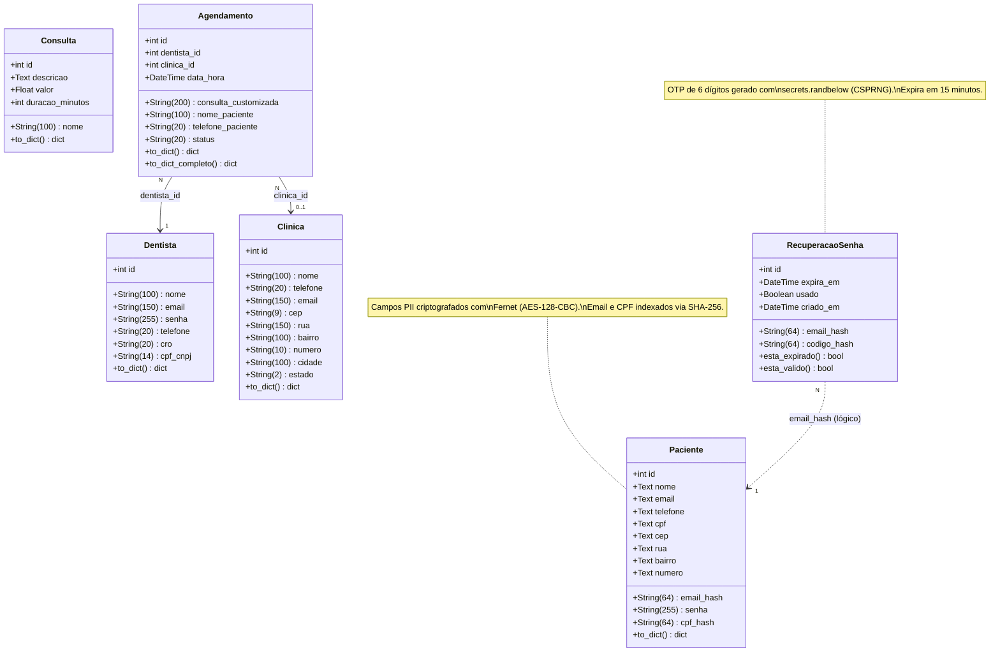

# Diagrama de Classes — ReOdonto

> Gerado com [Mermaid](https://mermaid.js.org/). Renderizável diretamente no GitHub, GitLab e na maioria das IDEs modernas.

---

## Descrição das Entidades

| Entidade | Tabela | Responsabilidade |
|---|---|---|
| `Paciente` | `paciente` | Usuário final do app. Dados PII criptografados com Fernet. |
| `Dentista` | `dentista` | Profissional que cria e gerencia agendamentos. |
| `Clinica` | `clinica` | Local físico onde as consultas acontecem. |
| `Consulta` | `consulta` | Catálogo de tipos de procedimento com duração e valor. |
| `Agendamento` | `agendamento` | Slot de atendimento vinculado a dentista e clínica. Suporta pacientes walk-in. |
| `RecuperacaoSenha` | `recuperacao_senha` | Token OTP temporário para redefinição de senha via email. |

## Relacionamentos

- **Agendamento → Dentista**: cada agendamento pertence a exatamente um dentista (`dentista_id FK`).
- **Agendamento → Clinica**: cada agendamento pode estar associado a uma clínica (`clinica_id FK`, opcional).
- **RecuperacaoSenha → Paciente**: associação lógica via `email_hash` (SHA-256), sem FK explícita no banco, para proteger a privacidade.

## Segurança dos Dados

- Campos PII do `Paciente` (nome, email, telefone, CPF, endereço) são **criptografados em repouso** com AES via Fernet.
- Email e CPF possuem colunas `*_hash` (SHA-256) para permitir buscas sem expor os dados cifrados.
- Senhas armazenadas com **bcrypt** (salt aleatório por usuário).
- Tokens JWT assinados com `JWT_SECRET_KEY` (HS256).
